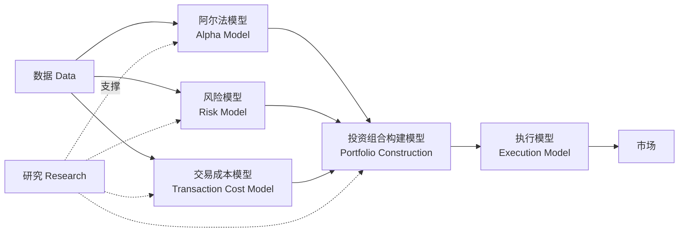

# 《打开量化投资的黑箱》（第 2 版）读书笔记

- **原书**：*Inside the Black Box: A Simple Guide to Quantitative and High Frequency Trading*（2nd ed.）
- **作者**：Rishi K. Narang（里什·纳兰）；译者：上官丽英、王思洋、王锦炎
- **中文版**：机械工业出版社，2016，ISBN 9787111537298

> 说明：本系列为个人学习笔记，按原书章节结构整理，内容为对书中观点的**概括与解读**，并非原文摘录；部分补充例子为笔者所加。如需准确表述请以原书为准。

## 全书框架

全书核心是一张"量化交易系统结构图"：

## 章节目录

### 第一部分 量化交易的世界
- [第 1 章 关注量化交易的原因](ch01-why-quant-matters.md)
- [第 2 章 量化交易简介](ch02-intro-to-quant-trading.md)

### 第二部分 打开黑箱
- [第 3 章 阿尔法模型：宽客如何盈利](ch03-alpha-models.md)
- [第 4 章 风险模型](ch04-risk-models.md)
- [第 5 章 交易成本模型](ch05-transaction-cost-models.md)
- [第 6 章 投资组合构建模型](ch06-portfolio-construction.md)
- [第 7 章 执行模型](ch07-execution.md)
- [第 8 章 数据](ch08-data.md)
- [第 9 章 研究](ch09-research.md)

### 第三部分 量化投资策略实战指南
- [第 10 章 量化策略的风险内生性](ch10-inherent-risks.md)
- [第 11 章 对量化交易的批评](ch11-criticisms.md)
- [第 12 章 评估宽客和量化交易策略](ch12-evaluating-quants.md)

### 第四部分 高速及高频交易
- [第 13 章 高速及高频交易概要](ch13-intro-to-hft.md)
- [第 14 章 高速交易](ch14-high-speed-trading.md)
- [第 15 章 高频交易](ch15-high-frequency-trading.md)
- [第 16 章 关于高频交易的争论](ch16-hft-controversy.md)
- [第 17 章 量化交易的展望](ch17-future.md)

## 一句话总结

量化交易不是神秘的"黑箱"，而是由**阿尔法、风险、成本、组合构建、执行**五个模块加上**数据与研究**组成的工程系统；理解每个模块的设计取舍，就能评估任何一个量化策略。
