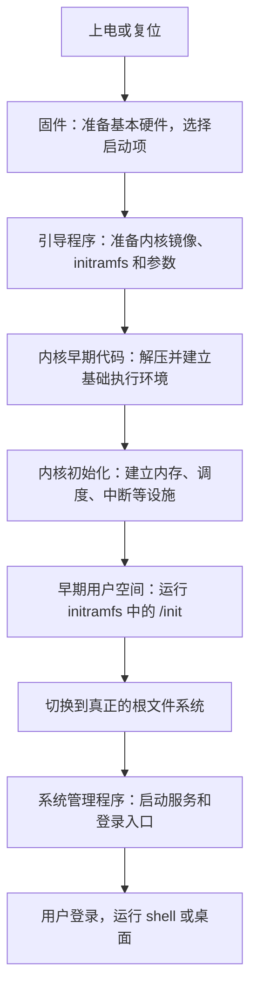
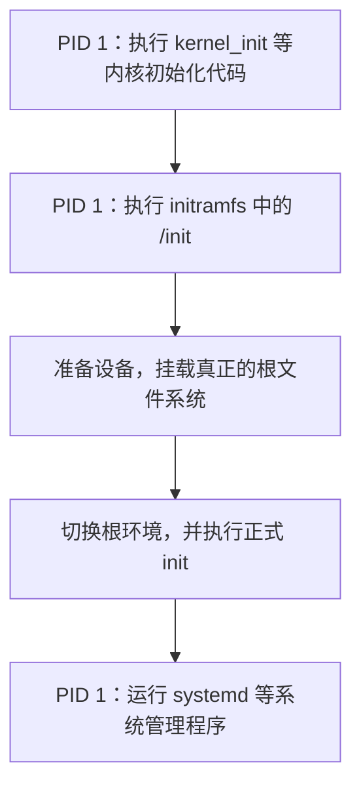

# 第 1 篇 启动与初始化

> 目标：沿着“按下电源 → 内核运行 → 找到系统盘 → 启动服务 → 出现登录界面”这条线，理解每一步由谁完成，以及为什么需要下一步。
>
> 本文以 **x86-64 电脑、UEFI 固件、使用 initramfs 的常见 Linux 发行版**为主要背景；涉及源码时固定参考 **Linux v6.12**。不同机器可以省略或替换部分环节，函数名也可能随版本变化。

如果你刚开始学习，不需要先记住 `startup_64`、`boot_params` 这些名字。先带着三个问题往下读：**现在 CPU 在执行谁的代码？这段代码已经具备什么能力？它还要准备什么，才能运行下一段代码？**

如果“用户态、内核态、进程”还比较陌生，可以先读[入门总览](linux-kernel-architecture.md)；本篇重点解释这些能力是怎样在开机过程中逐步建立起来的。

## 1. 先看全景：启动是一连串准备和交接

平时运行一个程序，操作系统已经替它准备好了内存、文件接口和调度器。但刚上电时，这些设施还没有建立，不能一开始就运行浏览器或 shell。

启动过程要从很少的能力开始：先让硬件达到能加载代码的状态，再把内核放进内存，让内核建立运行环境，最后启动用户空间的程序。



这张图画的是一条常见路径。固件也可以通过内核的 EFI stub 直接加载内核，不一定存在单独的 GRUB；某些系统也不需要外部 initramfs。先掌握主线，再理解这些变体。[内核 EFI stub 文档](https://docs.kernel.org/6.12/admin-guide/efi-stub.html)

| 阶段 | 此时主要运行谁的代码 | 这一阶段要交付什么 |
|---|---|---|
| 固件 | 主板固件，例如 UEFI 实现 | 基本可用的硬件环境，以及选中的启动程序 |
| 引导程序 | GRUB、systemd-boot 等 | 放入内存的内核及启动材料 |
| 内核初始化 | Linux 内核 | 可以管理资源、调度任务、运行用户程序的环境 |
| 早期用户空间 | initramfs 里的 `/init` 及相关工具 | 找到并挂载真正的根文件系统 |
| 正式用户空间 | systemd 等 init 系统及其启动的服务 | 日常运行所需的服务、终端或图形登录入口 |

这里说“把控制权交给下一阶段”，主要指 **CPU 开始执行下一阶段的代码**。这不总是创建新进程：在内核建立进程管理之前，还不能用平时的进程模型描述所有步骤。

## 2. 第一棒：没有操作系统时，固件怎么先跑起来？

### 2.1 最初运行的是固件

CPU 复位后，会从硬件规定的入口开始执行代码。平台把固件安排在这个启动路径上，所以它不需要先有 Linux 才能运行。

固件可以先理解为保存在主板非易失性存储器中的一套基础软件。它负责完成启动所需的硬件初始化，例如让内存可用、发现必要的设备，并选择下一步要加载的程序。屏幕上看到的主板标志和固件设置界面，往往属于这个阶段。

固件只需要把机器带到足以继续引导的状态，操作系统随后还会接管并进一步配置设备。

### 2.2 UEFI 和 BIOS 是两类引导环境

传统 BIOS 常从启动磁盘上的引导扇区代码开始执行，再由后续引导代码逐步加载系统。UEFI 提供了更完整的加载环境，可以按照启动配置加载 EFI 可执行程序；常见启动文件存放在 **EFI System Partition（ESP，EFI 系统分区）**中。

在一台使用 GRUB 的 UEFI 电脑上，可以先把这一段理解成：

```text
UEFI 固件
  → 选择启动项
  → 加载该启动项指定的 EFI 引导程序
  → 引导程序继续准备 Linux
```

UEFI、GRUB 和 Linux 是不同的软件。选择 Linux 启动项时，固件不会因此自动拥有 Linux 的全部文件系统、驱动和调度功能。EFI stub 则是内核中用于适配 EFI 加载方式的一小段代码，使内核镜像能够作为 EFI 程序被加载。[EFI stub 的职责](https://docs.kernel.org/6.12/admin-guide/efi-stub.html)

## 3. 第二棒：引导程序把什么交给内核？

### 3.1 三份主要启动材料

引导程序的重要任务，是把启动 Linux 所需的东西放到内存中，并按约定进入内核。常见材料有三类：

| 材料 | 可以怎样理解 | 常见形式 |
|---|---|---|
| 内核镜像 | 接下来要运行的内核代码及数据 | 发行版中的 `/boot/vmlinuz-*` |
| initramfs | 一套放在内存中的早期启动工具和文件 | `/boot/initrd.img-*` 或 `/boot/initramfs-*.img`，名称因发行版而异 |
| 内核命令行 | 告诉内核及早期启动程序本次怎样启动 | `root=...`、`console=...`、`quiet` 等参数 |

“镜像”在这里就是用于加载的一份程序或数据映像。x86 上的 `bzImage` 是一种内核启动镜像格式，其中包含启动代码和通常经过压缩的内核主体；名字里的 `bz` 不表示必须使用 bzip2。

引导程序可以借助固件服务，也可以使用自己的驱动或文件系统支持来读取这些文件。它提供的是完成引导所需的能力；Linux 接管之后，会建立自己的设备管理和 I/O 路径。

### 3.2 为什么需要启动协议？

只把内核文件复制到内存里，还不够。内核还需要知道：

- 自己被放在什么位置，应该从哪个入口开始执行。
- 哪些内存可用，哪些区域必须保留。
- initramfs 被放在哪里，有多大。
- 本次启动携带了哪些参数。

这些约定构成了**启动协议**。在 x86 的相关协议中，`boot_params` 是传递启动信息的重要结构；经 EFI stub 引导时，也会由相应代码完成信息接收和整理。

32 位、64 位和 EFI 入口对 CPU 状态、参数和地址布局的要求并不相同，所以不能把所有 x86 启动方式统一写成“跳到同一个 `startup_32`”。第一次阅读时，理解“交接双方必须遵守接口约定”就足够了。[Linux/x86 启动协议](https://docs.kernel.org/6.12/arch/x86/boot.html)

### 3.3 命令行参数在解决什么问题？

| 参数示例 | 表达的意图 |
|---|---|
| `root=UUID=...` | 在常见发行版的早期用户空间帮助下，定位作为根文件系统的设备 |
| `console=ttyS0,115200` | 指定串口控制台及波特率，用于输出和观察日志 |
| `quiet` | 减少通常显示在控制台上的内核信息 |
| `initcall_debug` | 记录初始化函数的调用和耗时，帮助定位初始化问题 |

这些是一组启动输入，内核和早期用户空间会各自解释自己负责的参数。它们不是需要在普通 shell 中逐条执行的命令。启动后可以通过 `cat /proc/cmdline` 查看本次收到的命令行。[内核参数文档](https://docs.kernel.org/6.12/admin-guide/kernel-parameters.html)

## 4. 第三棒：内核先为自己建立运行环境

### 4.1 为什么还不能立刻调用普通内核功能？

平时的程序可以直接申请内存、等待磁盘、创建线程，是因为底层设施已经就绪。刚进入内核时，这些前提未必成立。

早期架构代码需要按照入口状态准备必要的 CPU 环境、栈和地址映射，并处理内核主体的解压、定位等工作。可以把“栈”先理解为保存函数调用状态的内存，把“地址映射”理解为 CPU 使用的地址与实际内存之间的对应关系。

如果连函数调用所需的栈和可访问的内存都没有准备好，就不能像普通 C 程序那样一路调用下去。

经过这段与体系结构密切相关的准备，启动路径会来到 `start_kernel()`。它是**通用内核初始化的重要入口**。在它之前，内核的早期代码已经在运行，甚至已经执行过 C 代码，因此它不是 CPU 开始执行内核的第一条指令。[x86 启动协议](https://docs.kernel.org/6.12/arch/x86/boot.html)、[v6.12 的 x86 早期入口代码](https://github.com/torvalds/linux/blob/v6.12/arch/x86/kernel/head64.c)

### 4.2 `start_kernel()` 怎样把基础设施建起来？

不妨把这一阶段看成逐步满足依赖条件。要调度任务，必须先建立调度器的数据结构；要处理设备中断，必须先建立相应的处理机制。

下面按职责归类，并非逐行调用顺序：

| 要建立的能力 | 代表性位置或函数 | 对后续步骤的意义 |
|---|---|---|
| 认识机器和启动输入 | `setup_arch()`、命令行处理 | 确定内存布局、平台信息和启动配置 |
| 更完整的内存管理 | `mm_core_init()` 等 | 支持后续对象和数据结构的分配 |
| 任务调度基础 | `sched_init()` | 为多个任务的运行安排做好准备 |
| 异常、中断和时间设施 | `trap_init()`、`init_IRQ()`、`timekeeping_init()` 等 | 能处理异常、设备通知和时间相关工作 |
| 文件与进程基础设施 | `vfs_caches_init()`、`proc_caches_init()` 等 | 支持后续文件访问和任务管理 |

具体依赖和顺序以源码为准。`start_kernel()` 完成基础准备之后，仍有后续初始化要做；不能把“到达这个函数”理解成“所有驱动都已加载”。[v6.12 的 init/main.c](https://github.com/torvalds/linux/blob/v6.12/init/main.c)

### 4.3 为什么要分出 PID 1 和 PID 2？

来到 `rest_init()` 附近时，系统开始把后续工作分配给不同任务：

- 创建将运行 `kernel_init` 的任务，使它取得 **PID 1**，继续完成初始化，并准备启动用户程序。
- 创建 **PID 2：`kthreadd`**，为后续创建许多内核线程提供支持。
- 启动 CPU 原来的执行路径转入该 CPU 的 **idle（空闲）任务**；当没有其他可运行任务时，它仍有明确的空闲执行路径。

PID 是任务所属进程的标识。PID 1 此时先执行内核初始化代码，后面才会装入第一个用户空间程序。v6.12 在这里使用 `user_mode_thread()` 创建这条将进入用户态的执行路径，不宜简单称它为一个永久留在内核里的普通内核线程。[v6.12 的 rest_init 与 kernel_init](https://github.com/torvalds/linux/blob/v6.12/init/main.c)

### 4.4 那么，大量驱动和子系统怎样依次初始化？

如果每增加一个驱动，都必须去 `start_kernel()` 手动加一行调用，维护会很困难。内核提供了 **initcall 注册机制**：子系统声明自己的初始化函数和级别，构建时把这些入口组织起来，启动时按规定阶段调用。

常见的分级顺序是：

```text
early → pure → core → postcore → arch → subsys → fs → rootfs → device → late
```

其中 `early_initcall` 在更早的阶段单独处理；后续级别由相应的初始化流程执行，许多工作由 PID 1 继续推进。理解这个机制时，重点是“注册入口，由框架统一调用”，不必先背所有宏名。级别提供阶段顺序，也不表示每个设备的异步探测一定在下一项开始前结束。[v6.12 的 initcall 定义](https://github.com/torvalds/linux/blob/v6.12/include/linux/init.h)

驱动的同一个 `module_init(...)` 入口，如果驱动编进内核，会参加启动时的初始化；如果编成 `.ko` 模块，则在模块加载时运行。**内建驱动**与**可加载模块**因此可能在不同时间完成初始化。[v6.12 的 module_init 定义](https://github.com/torvalds/linux/blob/v6.12/include/linux/module.h)

另一个常见标记是 `__init`：它告诉内核，这段代码只在初始化阶段需要。相关初始化工作结束后，可以回收这类代码占用的内存，供其他用途使用；持续运行时仍会调用的代码不能随意这样标记。[初始化代码与数据标记](https://github.com/torvalds/linux/blob/v6.12/include/linux/init.h)

## 5. 第四棒：initramfs 为什么是启动的关键一环？

### 5.1 先理解“根文件系统”

Linux 的路径从 `/` 开始。日常看到的 `/etc`、`/usr`、`/home` 等目录，都组织在这棵目录树下，其中还可以挂载其他文件系统。

**根文件系统**提供这棵树的根。把某个文件系统“挂载”到一个目录，就是让这个目录成为访问该文件系统内容的入口。

在常见安装中，日常使用的根文件系统位于硬盘分区、逻辑卷或加密卷上。本文把它称为“真正的根文件系统”，用来与启动初期那个临时环境区分。

这里的“根”说的是目录树顶端 `/`，与管理员账号 root 是不同的概念。

### 5.2 启动为什么会遇到一个依赖循环？

想象系统盘采用了加密存储，而且访问它所需的某个驱动没有编进内核，而是作为模块保存在磁盘上：

```text
要读取系统盘上的文件
  → 需要存储驱动，并且可能需要解密、组装逻辑卷
  → 需要驱动模块和用户空间工具
  → 这些文件平时又保存在尚未能访问的系统盘上
```

initramfs 解决的方法是：**提前准备一套足够小的工具和文件，在真正的系统盘可用之前，先把它们放进内存。**

这样，早期启动程序就能使用这套环境加载驱动、处理加密或逻辑卷、找到根文件系统，再进入完整系统。简单的系统如果已把必要驱动编进内核，而且不需要这类用户空间准备，也可以直接挂载根文件系统，不依赖外部 initramfs。[根文件系统与 init 加载的前提](https://docs.kernel.org/6.12/admin-guide/init.html)

### 5.3 initramfs 是文件包，展开后才形成启动环境

现代 initramfs 通常以 cpio 归档的形式提供，可以压缩，也可以包含多个归档片段。引导程序把外部归档加载到内存，内核再把内容展开到最初的 **rootfs** 中；initramfs 也可以在构建时嵌入内核。

rootfs 是内核的初始根文件系统实例，后端可以是 ramfs 或 tmpfs，取决于配置和启动方式。不要把“initramfs”“tmpfs”“硬盘上的根分区”当作同一个东西。[Ramfs、rootfs 与 initramfs](https://docs.kernel.org/6.12/filesystems/ramfs-rootfs-initramfs.html)

一个教学用的最小目录树可能包含：

```text
/                  启动初期的根目录
├── init           早期用户空间的入口
├── bin/           启动时需要的少量工具
├── lib/           工具依赖的库、必要的驱动模块等
└── dev/           访问设备所需的入口
```

实际内容由发行版和生成工具决定；例如 dracut、initramfs-tools、mkinitcpio 会按自己的方式准备它。`/init` 可以是可执行程序，也可以是带有可用解释器的脚本。

历史上的 **initrd** 常指把文件系统镜像放在内存块设备上的方案；现代文件即使仍叫 `initrd.img`，里面也经常是 initramfs 归档。判断内容不能只看文件名。[旧 initrd 与 initramfs 的区别](https://docs.kernel.org/6.12/filesystems/ramfs-rootfs-initramfs.html)

### 5.4 `/init` 一旦执行，就已经进入用户空间

在这条常见路径上，PID 1 完成必要的内核初始化后，装入并执行初始根里的 `/init`。**这一步已经运行用户空间代码了**，即使此时真正的根文件系统还没有挂载。

早期用户空间和日常用户空间使用的是同一个正在运行的内核。区别主要在于它们看到的文件环境和承担的任务。

`/init` 及其启动的工具通常按需要完成以下工作：

1. 准备 `/proc`、`/sys`、`/dev` 等接口，获得硬件和设备信息。
2. 请求内核加载所需驱动模块，等待相关设备出现。
3. 找到目标设备；必要时解锁加密卷、组装 RAID（多盘阵列）或激活逻辑卷。
4. 挂载真正的根文件系统，例如先挂到 `/sysroot` 或 `/newroot`。
5. 切换根目录环境，并启动真正根里的 init 系统。

这些操作不要求全部发生：没有磁盘加密的机器，就不需要解锁步骤。用户程序负责组织启动流程，实际的设备操作、挂载和模块加载仍通过内核完成。[systemd 的启动阶段说明](https://www.freedesktop.org/software/systemd/man/latest/bootup.html)

### 5.5 `switch_root` 改变了什么？

假设真正的根已经挂到了 `/sysroot`，那么切换之前：

```text
/init                    临时环境里的启动程序
/sysroot/etc/            真正系统里的配置目录
/sysroot/usr/            真正系统里的程序和库
/sysroot/sbin/init        真正系统里的 init 入口
```

切换之后，真正根成为新的 `/`，原来的 `/sysroot/etc/` 就对应新的 `/etc/`。相关工具会处理必要挂载点的迁移、旧环境的清理，以及新 init 程序的执行。内存可以随着旧文件和引用的释放而回收，不能简单理解为“把 rootfs 对象直接卸载掉”。[switch_root 文档](https://man7.org/linux/man-pages/man8/switch_root.8.html)

**这个过程没有再次启动一遍内核，也不要求创建一个新的 PID 1。** 在典型交接中，PID 1 通过 exec 机制换成真正系统里的 init 程序，进程编号保持不变。

`exec` 的意思是“让当前进程装入并执行另一个程序”，与“新建一个进程”不同。成功后，原来的程序代码被替换，后续从新程序继续运行。[execve 文档](https://man7.org/linux/man-pages/man2/execve.2.html)



不是每台机器都经历这张图中的每一个程序名。例如，initramfs 中的 `/init` 本身就可能是 systemd。需要抓住的是 **PID 1 的启动职责和所执行的程序会随阶段变化**。

## 6. 第五棒：谁把系统变成可以登录的样子？

### 6.1 PID 0、PID 1、PID 2 各自负责什么？

以下说的是常规 Linux 主机的初始 PID 命名空间；容器看到的进程编号和可见范围可能不同。

| 标识 | 主要角色 | 启动后的典型表现 |
|---|---|---|
| PID 0 / idle | 每个 CPU 的空闲执行路径，启动 CPU 从初始任务继续走到这里 | 不以普通用户进程的方式出现在 `ps` 列表里 |
| PID 1 / init | 从内核初始化过渡到用户空间，承担 init 的职责 | 常见为 systemd，也可以是其他 init 实现 |
| PID 2 / kthreadd | 处理许多内核线程的创建请求 | 在主机上通常可由 `ps` 看到，例如 `[kthreadd]` |

`kthreadd` 不负责显示登录界面。它服务于内核内部的后台工作；systemd 等 init 系统则负责组织用户空间服务。

容器自己的 PID 1 不等于宿主机的 PID 1。例如，容器中可能直接让一个应用成为 PID 1，也不一定能看到宿主机的 kthreadd。PID 1 在信号处理和进程回收方面还有特殊规则，不能笼统理解成“任何地方的 PID 1 都绝对杀不掉”。这些细节可以在学习进程管理时再展开。[PID 命名空间文档](https://man7.org/linux/man-pages/man7/pid_namespaces.7.html)

### 6.2 systemd 做的是用户空间的组织工作

在采用 systemd 的发行版中，正式 init 入口常通过 `/sbin/init` 指向 systemd。它运行在用户空间，负责按照配置建立和维护服务环境，例如日志、设备管理、网络、远程登录和本地登录入口。[systemd 文档](https://www.freedesktop.org/software/systemd/man/latest/systemd.html)

这些工作有依赖关系，也有可以同时进行的部分。例如，需要某个文件系统的服务要等它挂载好；互不依赖的服务则可以并行启动。

systemd 用 **unit（单元）**描述需要管理的对象，用 **target（目标）**组织一组单元。常见的 `multi-user.target` 面向多用户运行环境，`graphical.target` 在相应依赖基础上组织图形环境。它们帮助表达启动目标，而不是让 CPU 切换到某种新的硬件模式。[systemd 的启动依赖关系](https://www.freedesktop.org/software/systemd/man/latest/bootup.html)

设备管理也是内核与用户空间配合的例子。内核报告设备变化，udev 根据规则设置设备节点权限、创建有意义的符号链接等；常见系统中的基本设备节点还会由内核的 devtmpfs 提供。不能把 `/dev` 中的一切都归结为 udev 独自创建。[udev 文档](https://www.freedesktop.org/software/systemd/man/latest/udev.html)

### 6.3 shell 和桌面终于从哪里出现？

常见的文本登录路径可以简化为：

```text
init 系统启动终端登录服务
  → getty 等程序准备终端并显示登录提示
  → login 等组件完成认证
  → 执行该用户配置的 shell
  → 用户输入命令，shell 再启动其他程序
```

图形登录则由显示管理器等组件建立登录界面，认证后启动图形会话。登录过程可以省略或调整，例如自动登录、SSH 登录、嵌入式设备的专用应用，都有各自的路径。

因此，看到 shell 提示符或桌面，说明除了内核初始化，还有一系列用户空间服务已经运行起来。**内核提供运行和管理这些程序的能力，具体启哪些服务由 init 系统及其配置决定。**

## 7. 把流程和自己的机器对应起来

### 7.1 先做几项只读观察

以下命令适用于 Linux 主机或虚拟机；macOS 原生环境无法直接复现这些 Linux 接口。容器通常也没有经历宿主机的完整启动链。

```bash
cat /proc/cmdline
ps -p 1,2 -o pid,ppid,comm,args
findmnt /
lsblk -f
```

| 观察项 | 应该关注什么 |
|---|---|
| `/proc/cmdline` | 本次启动传入了哪些参数；是否能找到 `root=`、`console=` 等信息 |
| PID 1 和 PID 2 | 正在使用哪种 init 系统，是否能看到 kthreadd |
| `findmnt /` | 当前 `/` 的来源和文件系统类型；此时通常已是切换后的根 |
| `lsblk -f` | 块设备、文件系统和标识信息，尝试与根设备对应起来 |

如果使用 systemd，还可以继续观察：

```bash
journalctl -b -k
systemd-analyze time
systemd-analyze critical-chain
```

`journalctl -b -k` 查看本次启动的内核日志，是否能读取取决于本机的日志保留和访问权限。`systemd-analyze time` 展示能够取得的阶段耗时；固件、引导程序或 initrd 的计时信息并不在每个环境中都完整提供。

`critical-chain` 帮助观察启动单元的等待关系。由于服务可以并行运行、还有异步初始化，单个单元耗时不能直接等同于它给整机启动增加的时间。[systemd-analyze 文档](https://www.freedesktop.org/software/systemd/man/latest/systemd-analyze.html)

### 7.2 卡住时，先判断停在哪一棒

| 现象 | 优先判断的阶段 | 可以先核对什么 |
|---|---|---|
| 固件找不到可启动项 | 固件 → 引导程序 | 启动项、ESP 和引导文件是否存在 |
| 引导菜单可用，但找不到内核镜像 | 引导程序 | 配置里的内核和 initramfs 路径是否正确 |
| 出现早期内核异常、还未启动 `/init` | 内核早期代码或初始化 | 最早错误日志、内核与平台是否匹配 |
| 落入 initramfs 的应急 shell | 早期用户空间 | 根设备是否出现，驱动、UUID、加密卷等是否准备好 |
| 提示 `No working init found` | 启动用户程序的交接 | init 文件、权限、解释器、动态链接器或依赖库是否完整 |
| 内核和系统管理程序已启动，某个服务失败 | 正式用户空间 | 该服务的配置、依赖和日志 |

“init 文件存在”也不保证可以执行：脚本需要正确的解释器，动态链接的程序需要相应的加载器和库，程序架构也要匹配。[内核关于 init 启动失败的说明](https://docs.kernel.org/6.12/admin-guide/init.html)

如果确实需要更多启动日志，可以按场景临时去掉 `quiet`，或使用 `initcall_debug` 观察初始化过程；要记录极早期输出，还需要正确配置该机器支持的 `earlycon` 等控制台方式。先确定所处阶段，再选择工具，比同时修改很多启动参数更容易判断原因。[启动参数说明](https://docs.kernel.org/6.12/admin-guide/kernel-parameters.html)

## 8. 补充：关机、Oops 和 panic

正常关机同样需要内核与用户空间配合。init 系统先组织服务停止和存储收尾，再请求内核进行最终关机或重启；内核调用设备与体系结构相关的处理路径，使机器复位或断电。[systemd 的关机流程](https://www.freedesktop.org/software/systemd/man/latest/bootup.html)

遇到内核错误时，需要区分两个概念：

- **Oops**：内核检测到严重错误并报告诊断信息。在某些情况下系统还能继续运行，但不能据此认为状态一定完好；发生位置和配置也可能让它进一步导致 panic。
- **panic**：内核进入无法按正常方式继续运行的错误处理流程。系统可能停住，也可能按配置重启或进入崩溃转储流程。

**kdump** 用于保存崩溃现场：预先保留并准备好捕获内核所需的资源，在崩溃时通过 kexec 进入捕获内核，由它读取前一个内核的内存并导出转储。它不是每台机器都会自动具备的默认结果，输出位置也取决于配置。[内核 Kdump 文档](https://docs.kernel.org/6.12/admin-guide/kdump/kdump.html)

## 9. 理解主线后，再沿源码查细节

下面路径均以 Linux v6.12 为参照。建议先从 `init/main.c` 看通用流程，再回头看架构相关的早期入口。

| 路径 | 适合带着什么问题阅读 |
|---|---|
| `arch/x86/boot/header.S` | x86 内核镜像怎样描述自己的启动信息 |
| `arch/x86/boot/compressed/head_64.S` | 压缩内核的早期入口怎样准备解压环境 |
| `arch/x86/kernel/head_64.S`、`head64.c` | 解压后的内核怎样走向通用初始化 |
| `arch/x86/kernel/setup.c` | x86 平台信息和内存布局怎样接入初始化 |
| `init/main.c` | `start_kernel`、`rest_init` 和 `kernel_init` 怎样连接起来 |
| `include/linux/init.h`、`include/linux/module.h` | 初始化函数怎样注册，内建代码与模块有什么区别 |
| `init/initramfs.c` | initramfs 归档怎样展开到初始根中 |
| `init/do_mounts.c` | 没有可用早期 `/init` 时，内核怎样准备根文件系统 |
| `kernel/reboot.c`、`kernel/panic.c` | 正常重启/关机与 panic 分别怎样处理 |

源码入口：[Linux v6.12](https://github.com/torvalds/linux/tree/v6.12)、[init/main.c](https://github.com/torvalds/linux/blob/v6.12/init/main.c)。阅读同一版本有助于避免把不同年代的函数名和入口拼成一条不存在的调用链。

## 10. 用五个问题检查是否理解

1. **还没有 Linux 时，谁先运行？** 固件及后续引导代码。硬件提供最初的执行入口，它们先准备加载内核所需的条件。
2. **到了 `start_kernel()`，内核才第一次开始运行吗？** 内核早期代码已经运行了一段时间；这里进入的是通用初始化的重要阶段。
3. **真正的根还没有挂载，怎么能先运行 `/init`？** 内核已把早期工具展开到内存中的初始根环境，PID 1 可以从那里执行用户程序。
4. **从 initramfs 切到正式系统，会再启动一个内核吗？** 通常仍是同一个内核，变化的是根目录环境，以及 PID 1 所执行的用户程序。
5. **为什么内核启动成功，仍可能没有登录界面？** 登录还依赖用户空间的服务、配置和设备；它们需要由 init 系统继续组织起来。

接下来读[第 2 篇：系统调用与内核入口](02-syscall-and-entry.md)，就会进入“系统已经启动后，用户程序如何反复请求内核服务”的阶段。
