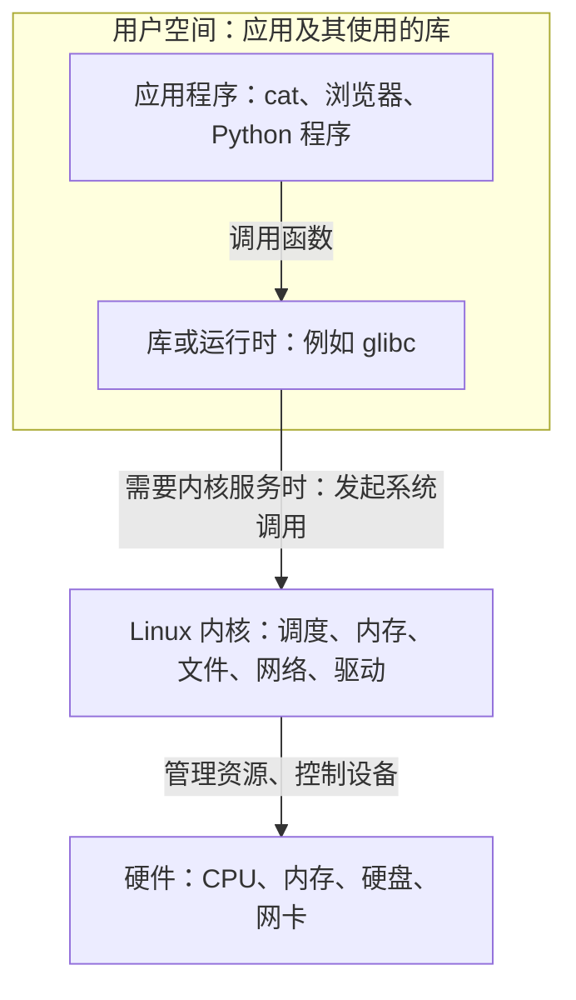
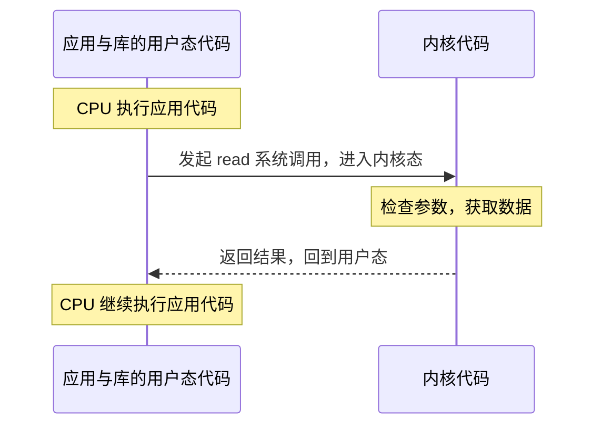
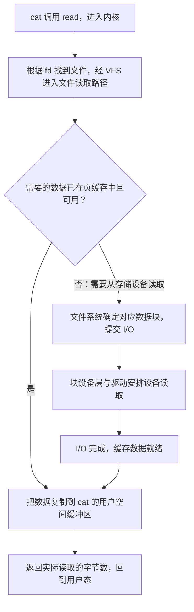

# Linux 内核的构成（入门版）

> 想深入了解整体设计和每个子系统的细节，请看进阶系列：[Linux 内核整体设计与子系统详解](index.md)。

## 1. 内核在哪一层

先从一个具体问题开始：**你让程序读取一个文件，CPU、程序和内核各自做了什么？**

理解这一节后，应该能分清三件事：CPU 执行指令，应用程序完成自己的业务，内核管理大家共同使用的资源。下面先解释它们的分工，再走一遍读文件的过程。这里以常见的 Linux 桌面或服务器为背景。

### 1.1 程序究竟由谁运行？

程序保存在磁盘上时，是包含指令和数据的文件。启动后，操作系统为它安排运行所需的环境；一个正在运行的程序实例，可以先理解为一个**进程（process）**。

例如，你同时打开浏览器和终端，又运行一个 Python 脚本，系统里就会有多个进程。每个进程都有自己的运行状态和内存视图；一个程序也可以启动多个进程。

**真正执行程序指令的是 CPU。** 加法、比较、循环，以及读写已经映射好且允许访问的内存，通常都可以由 CPU 直接执行，不必每一步都请求内核。

比如，程序把内存中的一组数字排序，比较和交换数字的工作主要发生在程序自己的代码里。内核会参与安排它什么时候运行、提供内存等工作，但不会替它逐个比较数字。

Linux 内核本身也是软件，也需要 CPU 执行它的指令。它在系统启动时被加载，随后持续承担资源管理和服务请求等工作。因此，学习内核时要区分：

- **CPU**：执行指令的硬件。
- **应用程序**：浏览网页、处理文本、运行模型等具体任务的代码。
- **内核**：管理 CPU 时间、内存和设备，并为应用提供受控服务的代码。

### 1.2 为什么需要一个内核来管理资源？

假设电脑上有很多程序，而且每个程序都能任意使用硬件，就会出现几个问题：

| 场景 | 如果缺少统一管理 | 内核提供的能力 |
|---|---|---|
| 浏览器和 Python 都想运行 | 某个程序可能一直占着 CPU | 调度：按照规则安排不同任务运行 |
| 两个程序都需要内存 | 一个程序可能覆盖另一个程序的数据 | 内存管理与隔离：建立各自可访问的地址范围 |
| 程序要读取文件 | 每个程序都得处理文件系统和硬盘的细节 | 文件接口：按路径打开、读取、写入文件 |
| 多个程序共用网卡 | 数据发送和接收难以协调 | 网络协议栈与驱动：管理连接、数据包和设备 |
| 一个普通程序想读别人的私有文件 | 缺少统一的访问规则 | 权限检查：判断是否允许这次操作 |

内核的两项主要工作由此就容易理解了：

**第一，管理和保护资源。** 谁可以访问哪些内存，哪个任务下一步使用 CPU，哪些文件可以打开，都需要规则。

**第二，提供抽象。** “抽象”就是给应用一个容易使用的概念，把下面复杂的实现细节封装起来。例如，应用使用“文件路径”和“文件内容”，通常不需要知道内容存在哪个磁盘块，也不需要自己给硬盘控制器发送命令。

硬盘、文件系统或网卡换了，应用仍然可以使用相似的文件和网络接口。这就是内核把硬件细节封装起来的价值。

### 1.3 从应用到硬件，分别有哪些层？



这张图表示**职责和服务关系**。应用的普通指令仍然由 CPU 直接执行；只有需要内核处理的工作，才会沿系统调用这条路径请求服务。

图里“库或运行时”这一层，也是在用户空间中运行的软件。比如 C 程序经常使用 glibc（一种常用的 C 标准库实现）提供的函数，Python 程序则通过解释器和相关库完成许多操作。这些软件会处理一部分工作，并在需要时调用内核接口。

Linux 严格来说是内核的名字；日常安装的 Ubuntu 等发行版，还包括命令行工具、库、服务和其他应用。终端里的 `cat`、`ls` 也是用户空间程序。

### 1.4 用户态和内核态，到底是什么“态”？

“态”在这里指 **CPU 执行代码时的权限状态**。常见 CPU 提供硬件支持，让普通应用的代码和内核代码拥有不同的操作权限。

| 对比项 | 用户态（user mode） | 内核态（kernel mode） |
|---|---|---|
| 通常执行什么代码 | 应用程序、库、语言运行时的代码 | 内核和内核驱动的代码 |
| 内存访问 | 受该进程的地址映射和权限限制 | 能管理映射，并访问内核有权访问的内存 |
| 系统级操作 | 不能随意更改页表、控制设备或关闭中断 | 能执行管理系统所需的特权操作 |
| 需要访问文件、网络等资源时 | 通过受控接口提出请求 | 检查请求，并调用相关子系统处理 |

这里的**页表**可以先理解为内核设置的一张“地址对应表”，其中记录程序使用的地址对应哪块内存，以及是否允许读写。CPU 的内存管理硬件按照这些规则进行地址转换和权限检查。这样，进程 A 拿到一个地址，并不意味着它可以访问进程 B 的私有数据。更详细的机制见[内核内存管理概念文档](https://docs.kernel.org/admin-guide/mm/concepts.html)。

例如，应用用一个无效指针访问没有权限的地址，硬件会触发异常，交给内核处理。如果这个访问无法合法完成，内核通常会向该进程发送信号；常见结果是进程因“段错误”（segmentation fault）退出。这种隔离能限制错误的影响范围，但应用仍可能通过文件、网络或共享资源影响其他程序。相关信号及其默认处理方式见 [signal(7)](https://man7.org/linux/man-pages/man7/signal.7.html)。

另外，有两个容易混淆的词：

- **用户空间 / 内核空间（space）**：侧重代码和数据所在的地址区域。
- **用户态 / 内核态（mode）**：侧重 CPU 此刻以什么权限执行代码。

它们密切相关，但描述的角度不同。也不要把“用户态”里的“用户”理解为普通账号：管理员账号 root 启动的应用通常仍在用户态执行。root 身份会影响内核的权限判断，并不会让应用的每条指令自动变成内核代码。进程身份与权限的概念见 [credentials(7)](https://man7.org/linux/man-pages/man7/credentials.7.html)。

### 1.5 系统调用：应用怎样请内核办事？

应用需要读取文件时，必须提供一个明确的请求，例如：“从已经打开的文件里，读取最多 100 个字节，放到我指定的缓冲区。”

**系统调用（system call，简称 syscall）就是应用请求内核服务的接口。** 常见的请求包括打开文件、读取数据、建立网络连接和创建进程。一般情况下，程序先调用库提供的包装函数，再由包装函数发起系统调用。[Linux 系统调用说明](https://man7.org/linux/man-pages/man2/syscalls.2.html)

以一次成功返回的 `read(fd, buf, 100)` 为例，先看整体过程。这里 `fd` 是已打开文件的编号，`buf` 表示接收数据的内存位置，第 1.7 节会用具体例子解释。

1. **准备请求。** 程序调用库里的 `read` 包装函数，包装函数按照约定准备系统调用编号和参数。
2. **进入内核。** 执行体系结构规定的指令，例如 x86-64 上的 `syscall`。CPU 切换权限状态，转到预先设置好的内核入口；硬件和入口代码配合保存返回所需的执行状态。
3. **内核处理。** 内核根据调用编号找到对应处理逻辑，检查文件描述符、缓冲区等参数，然后进行读取。必要时，这一步会等待数据。
4. **返回结果。** 请求完成后，内核安排返回用户态，程序从调用返回的位置继续执行，得到实际读到的字节数；失败时，库函数会提供错误信息。

具体指令与参数传递方式由 CPU 架构规定，初学时不需要记寄存器名称；关键是理解这里经过了**受控的入口和返回过程**。[syscall(2)](https://man7.org/linux/man-pages/man2/syscall.2.html)



图中两列表示两类代码，不能理解成两个进程在发消息。系统调用期间，通常是**当前线程进入内核，执行内核为它处理请求的代码**；线程可以先理解为进程中的一条执行线。

这也解释了为什么要区分下面两个动作：

- **用户态 / 内核态切换**：改变当前执行代码的权限状态。
- **任务上下文切换**：调度器让 CPU 从一个线程转去运行另一个线程。

一次系统调用可以进入内核、完成工作、直接返回，期间不切换到别的线程。如果读取必须等待硬盘，当前线程可能进入等待状态，这时调度器可以让其他可运行线程使用 CPU；调度也可能因其他原因发生。因此，系统调用过程中可能发生上下文切换，但二者是不同的概念。Linux 的调度对象更准确地说是线程，见 [sched(7)](https://man7.org/linux/man-pages/man7/sched.7.html)。

最后，系统调用是应用**主动请求服务**的重要入口。CPU 也会因硬件中断或异常进入内核，例如网卡通知有数据到达，或访问内存时触发缺页异常。缺页异常可以发生在合法内存尚未准备好对应的物理页时，需要内核补齐，未必是程序出错。不应把系统调用理解成进入内核的唯一途径。[内核入口与退出处理文档](https://docs.kernel.org/core-api/entry.html)

### 1.6 库函数和系统调用有什么区别？

在 C 代码里，它们往往都写成 `某个名字(...)`，所以很容易混在一起。区别在于：**调用普通函数，可以继续在用户态执行；发起系统调用，则会进入内核。**

| 写下的操作 | 主要做什么 | 是否必然因此发起系统调用 |
|---|---|---|
| `strlen(s)` | 在用户空间计算字符串长度 | 不需要；它本身可以用普通指令完成 |
| `printf(...)` | 格式化文本，再通过标准输出流输出 | 不一定每次都调用；数据可能先放在库的缓冲区里 |
| `malloc(100)` | 从分配器管理的内存中找出一块可用空间 | 不一定每次都调用；必要时才向内核申请更多地址空间 |
| `read(fd, buf, n)` | 请求从文件描述符读取数据 | 常规 Linux C 库实现会发起对应系统调用 |

例如，`printf` 可能先在用户空间完成数字到文字的转换，并把文本暂存在缓冲区，等刷新时再通过底层写入操作输出。因此，“调用一次 `printf`”和“进行一次 `write` 系统调用”没有一一对应的关系。[标准 I/O 文档](https://man7.org/linux/man-pages/man3/stdio.3.html)

同样，`malloc` 可以重复利用分配器已经管理的内存；需要扩展时，glibc 可以通过 `brk`、`mmap` 等接口向内核申请。此处先记住“库可以自己完成一部分工作”即可。[malloc 文档](https://man7.org/linux/man-pages/man3/malloc.3.html)

这里讨论的是函数是否主动发起系统调用。执行普通代码时，也可能因为缺页异常、中断等原因暂时进入内核。

### 1.7 把这些概念串起来：运行 `cat /etc/hostname`

`cat` 的任务是把输入内容复制到标准输出。`/etc/hostname` 通常是一个保存主机名的文本文件。先假设它存在，内容是 `study-box` 加一个换行符，共 10 个字节。

暂时略过 shell（接收命令的命令行解释器）启动程序的过程，只看 `cat` 开始运行后的一条常见读写路径。以下是教学模型，具体实现可能使用其他 I/O（输入/输出）接口或优化。

**第一步：打开文件，取得文件描述符。**

`cat` 请求打开 `/etc/hostname`。内核解析路径、检查访问权限，并在成功时返回一个非负整数，比如 `3`。这个整数叫**文件描述符（file descriptor，简称 fd）**，可以把它理解为当前进程使用这个已打开文件的“编号”。

以后说“读取 fd 3”，内核就可以查到它对应的文件。这个编号属于当前进程的文件描述符表，其他进程的 fd 3 可以指向完全不同的对象。

打开文件的结果是取得这个引用；文件内容还没有通过这一步交给应用的读取缓冲区。打开过程中可能读取目录等元数据，因此也不能把它理解成“打开绝不会访问磁盘”。C 代码中的 `open()` 在 glibc 2.26 起通常通过 `openat` 系统调用完成。[open / openat 文档](https://man7.org/linux/man-pages/man2/open.2.html)

**第二步：读取文件内容，放到程序的内存中。**

`cat` 准备一块缓冲区，也就是用来暂存数据的内存，再请求 `read(fd, buf, 容量)`。内核把读取到的内容放入这块内存，并返回实际读到的字节数。对这个小文件，假设一次读到了全部 10 个字节。

普通文件的缓冲读取会使用 **page cache（页缓存）**：内核把文件内容的一部分保存在内存中，供后续读取使用。需要的数据已在缓存中且可用时，可以从缓存提供；否则需要让数据准备好，可能涉及存储设备 I/O。缓存的具体分支会在第 3 节展开。[Page Cache 文档](https://docs.kernel.org/mm/page_cache.html)

**第三步：把缓冲区里的内容写到标准输出。**

`cat` 接着调用类似 `write(1, buf, 10)` 的操作。`1` 是标准输出的文件描述符：在交互式终端里通常连接终端，也可以通过重定向连接文件，或通过管道连接另一个程序。

`write` 负责把缓冲区中的字节写给对应输出对象。终端场景下，后续由终端相关组件完成显示；`cat` 不需要自己绘制屏幕像素。一次写入也可能只完成部分数据，程序需要根据返回值继续处理。[write 文档](https://man7.org/linux/man-pages/man2/write.2.html)

**第四步：读到文件末尾，关闭文件。**

程序继续读取，直到对普通文件的非零长度读取请求返回 `0`，表示已到文件末尾；然后关闭输入文件描述符。大文件会经历多轮“读一块、写一块”，一次 `read` 也不保证填满整个缓冲区。[read 文档](https://man7.org/linux/man-pages/man2/read.2.html)、[close 文档](https://man7.org/linux/man-pages/man2/close.2.html)

这样，一次 `cat` 命令就拆成了多个独立请求：

```text
open/openat：取得文件描述符
     ↓
read：文件内容 → cat 的用户空间缓冲区
     ↓
write：cat 的缓冲区 → 标准输出
     ↓
重复读取和输出，直到读到文件末尾
     ↓
close：关闭输入文件描述符
```

在这些系统调用之间，`cat` 会回到用户态，判断返回值、更新计数并决定下一步操作。

### 1.8 动手观察：程序实际提出了哪些请求？

在已经安装 `strace` 的 Linux 环境里，可以运行：

```bash
strace -e trace=open,openat,read,write,close cat /etc/hostname
```

`strace` 会记录系统调用的名称、参数和返回值；`-e trace=...` 让它只显示列出的这些调用。这个实验需要 Linux 环境，在 macOS 上学习时可以使用 Linux 虚拟机。[strace 文档](https://man7.org/linux/man-pages/man1/strace.1.html)

下面是**教学示意输出**，省略了程序启动等相关调用；缓冲区大小、描述符编号和具体调用都可能随环境变化：

```text
openat(AT_FDCWD, "/etc/hostname", O_RDONLY) = 3
read(3, "study-box\n", 4096)              = 10
write(1, "study-box\n", 10)               = 10
read(3, "", 4096)                         = 0
close(3)                                 = 0
```

可以这样逐行读：

| 看到的内容 | 含义 |
|---|---|
| `openat(..., O_RDONLY) = 3` | 以只读方式打开，成功取得 fd 3；`AT_FDCWD` 是目录参数，此处使用绝对路径，可以先忽略它 |
| `read(3, ..., 4096) = 10` | 最多读取 4096 字节，这次实际读到 10 字节 |
| `write(1, ..., 10) = 10` | 请求向标准输出写入 10 字节，这次全部写入 |
| `read(3, ..., 4096) = 0` | 继续读取时到达文件末尾 |
| `close(3) = 0` | 关闭 fd 3，返回 0 表示成功 |

这里的 4096 只是示例选择的缓冲区容量，不是在规定系统的内存页大小。实际日志里还可能看到共享库等文件被打开，可以从包含 `"/etc/hostname"` 的那一行开始追踪。这个工具展示的是系统调用边界，内核内部的函数调用和缓存是否命中，需要其他观测手段。

读完后，可以用三个问题检查自己是否理解：

1. **程序给两个数字做加法，要调用内核来计算吗？** 通常不需要，CPU 可以直接执行程序的计算指令。
2. **`open` 成功后，文件内容已经在程序的读取缓冲区里了吗？** 还没有；它返回文件描述符，读取内容是后续 `read` 等操作的工作。
3. **一次系统调用一定会换到另一个进程运行吗？** 不一定；进入内核态和调度其他线程是不同的动作。

## 2. 五大核心子系统

| 子系统 | 职责 | 类比 | 关键词 |
|---|---|---|---|
| **进程管理与调度** | 管理进程/线程，决定谁在 CPU 上跑、跑多久 | 会议室排班员 | `task_struct`、CFS/EEVDF、上下文切换、fork/exec |
| **内存管理** | 分配和回收内存；管理进程的虚拟地址空间 | 仓库管理员加地址翻译员 | 虚拟内存、页（常见基本页大小为 4 KiB，取决于架构和配置）、页表、缺页异常、swap、`kmalloc` |
| **虚拟文件系统 VFS** | 统一的文件接口，屏蔽 ext4/xfs/FAT/NFS 等差异 | 万能插座转换头 | inode、dentry、file、page cache |
| **网络协议栈** | 实现 TCP/IP，数据包层层处理后交给 socket | 邮局分拣中心 | socket、`sk_buff`、netfilter |
| **设备驱动** | 直接和硬件打交道，屏蔽硬件差异 | 每种设备配一名专属翻译 | 字符设备、块设备、网络设备 |

补充说明：

- **一切皆文件**：设备（`/dev/sda`）、进程信息（`/proc`）、内核开关（`/sys`）都以文件形式出现。例如用 `echo 1 > tracing_on` 打开 ftrace。
- **网络收包路径**：网卡 → 驱动 → `netif_receive_skb` → `ip_rcv` → `tcp_v4_rcv` → socket → 应用。
- **驱动代码在内核源码中占很大比重**，因为硬件种类非常多；具体比例取决于内核版本和统计口径。

### 支撑部分

| 部分 | 作用 |
|---|---|
| 中断处理 | 硬件"拍肩膀"通知 CPU，比如网卡收到包、键盘被按下 |
| 系统调用层 | 应用主动请求内核服务的接口（openat、read、write、fork…；可用调用随架构和版本变化） |
| 进程间通信 IPC | 管道、信号、共享内存、消息队列 |
| 安全模块 | 权限检查、SELinux、AppArmor |
| 架构相关代码 | x86、ARM64、RISC-V 等不同 CPU 的底层细节 |

## 3. 各子系统如何协作：`cat /etc/hostname`

第 1 节从应用的角度，把命令拆成了打开、读取、输出和关闭。现在沿同一条路径看内核内部的分工。下面假设输入文件位于本地 ext4 文件系统，使用普通的缓冲读取；其他文件系统或 I/O 方式的细节会不同。

**打开阶段：VFS 与具体文件系统配合找到文件。** `open/openat` 进入内核后，通过 VFS 解析路径，结合具体文件系统处理目录和文件信息，进行相应权限检查，并在成功时返回文件描述符。这一阶段也可能因读取元数据而访问存储设备。

**读取阶段：根据页缓存状态决定怎样取得内容。** 在这个简化模型中，关注的是当前请求所需的那部分数据：



这里有三点需要分开理解：

- **缓存命中时**，所需内容已在内存中，可以从缓存提供，不需要为取得这部分内容再等一次磁盘读取。
- **需要等待 I/O 时**，`cat` 的线程可能睡眠，调度器可以让其他可运行线程使用 CPU。I/O 完成后，等待者可以被唤醒；被唤醒表示可以再次参与调度，不保证立即运行。
- **从缓存取到内容后**，普通缓冲 `read` 还需要把数据复制到应用提供的缓冲区。内核会使用适当的用户内存访问机制完成复制，具体函数名依内核版本和路径而异。

设备常通过中断报告完成事件，也存在轮询等方式。图中只画出了主要的数据流；实际实现还会处理预读、部分缓存命中、已有 I/O 尚未完成等情况。[内核内存管理概览：Page cache](https://docs.kernel.org/admin-guide/mm/concepts.html#page-cache)、[Page Cache 文档](https://docs.kernel.org/mm/page_cache.html)

**输出与关闭阶段：应用继续发起下一次请求。** `read` 返回用户态后，`cat` 再通过 `write(1, ...)` 把内容写到标准输出。这个输出可能是终端、文件或管道，内核按对应对象处理；读取到文件末尾后，程序关闭输入文件描述符。

现在可以把子系统和实际工作对应起来：VFS 与文件系统处理文件，内存管理支持页缓存和缓冲区访问，驱动与块设备层处理存储 I/O，调度器处理线程运行和等待。想先观察请求边界，可以用 `strace`；想继续追踪内核内部的函数，再使用 ftrace、kprobe、bpftrace 等工具。

## 4. 两个重要的设计特点

### 宏内核（Monolithic Kernel）

上面这些子系统全部运行在**同一个内核地址空间**里，相互之间直接调用函数。

- **优点**：速度快，没有跨进程通信的开销。
- **缺点**：任何一处出 bug（比如驱动）都可能让整个系统崩溃（Oops/panic）。

对比**微内核**（Minix、QNX）：内核只保留最核心的功能，驱动、文件系统作为独立进程运行。这样更稳定，但进程间通信多，开销更大。

### 可加载模块（Loadable Kernel Module, `.ko`）

Linux 虽然是宏内核，但支持在运行时插入代码，不用重新编译整个内核。大部分驱动都以模块形式存在。

```bash
lsmod                 # 查看已加载的模块
sudo modprobe xxx     # 加载模块
sudo rmmod xxx        # 卸载模块
```

## 5. 源码目录结构

源码地址：<https://github.com/torvalds/linux>

| 目录 | 内容 |
|---|---|
| `kernel/` | 进程调度（`kernel/sched/`）、信号、时间、ftrace（`kernel/trace/`） |
| `mm/` | 内存管理 |
| `fs/` | VFS 和各种文件系统（`fs/ext4/`、`fs/open.c`） |
| `net/` | 网络协议栈（`net/ipv4/tcp*.c`） |
| `drivers/` | 设备驱动（占比最大） |
| `arch/` | CPU 架构相关代码（`arch/x86/`、`arch/arm64/`） |
| `include/` | 头文件 |
| `init/` | 内核启动入口（`init/main.c` 中的 `start_kernel`） |
| `ipc/` | 进程间通信 |
| `security/` | 安全模块 |
| `block/` | 块设备层 |

## 6. 学习路线

1. **先站在用户态看内核**（不用写内核代码）
   - `strace ls`：看程序调用了哪些系统调用（推荐作为第一步）
   - 逛 `/proc`、`/sys`：`cat /proc/cpuinfo`、`cat /proc/meminfo`、`ls /proc/self/`
   - `top`、`free`、`vmstat` 背后的数据都来自内核
2. **补基础**：C 语言（指针、结构体）、操作系统原理（进程、虚拟内存、中断）
3. **动手观察内核**：用 ftrace、kprobe、bpftrace 跟踪一次 `read()` 的调用链
4. **写一个 hello world 内核模块**，体验加载和卸载
5. **按兴趣深入某个子系统**，读源码可以用 <https://elixir.bootlin.com> 在线跳转

**推荐书籍**

- 入门：《Linux 内核设计与实现》（Robert Love，LKD）
- 进阶：《深入理解 Linux 内核》（ULK，版本较老但原理扎实）、《奔跑吧 Linux 内核》（中文，基于较新的内核）

## 结论

Linux 内核是一个运行在特权模式下的大程序，通过**系统调用**为应用提供服务。内部由**进程调度、内存管理、文件系统、网络、设备驱动**五大块组成，所有部分在同一地址空间协作（**宏内核**），同时可以通过**可加载模块**灵活扩展。
