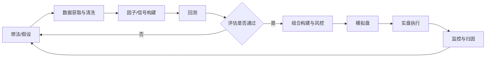

# 量化交易核心概念入门教程

> 目标：用一篇笔记把量化交易的"骨架"搭起来——它是什么、一个策略从想法到上线要经过哪些环节、每个环节有哪些核心概念和常见坑。
>
> 声明：本文仅为学习笔记，不构成任何投资建议。文中数值多为经验性估计值，仅作量级参考。

---

## 1. 什么是量化交易

**量化交易（Quantitative Trading）**：用数学模型和程序代替（或辅助）人的主观判断，基于历史数据发现规律，并按事先定义好的规则自动或半自动地执行买卖。

与主观交易的对比：

| 维度 | 主观交易 | 量化交易 |
|---|---|---|
| 决策依据 | 经验、直觉、基本面研读 | 数据、统计规律、模型 |
| 可复现性 | 低，因人而异 | 高，规则明确可回测 |
| 覆盖广度 | 精力有限，盯少数标的 | 可同时处理成千上万个标的 |
| 情绪影响 | 易受贪婪/恐惧影响 | 纪律性强（但设计者仍有偏差） |
| 主要风险 | 判断失误、情绪化 | 过拟合、模型失效、技术故障 |

一句话：**量化 = 可验证的假设 + 数据 + 纪律化执行 + 风险控制**。

---

## 2. 量化交易的完整流程



下面按这个流程逐一介绍核心概念。

---

## 3. 数据：一切的起点

### 3.1 常见数据类型

| 类型 | 例子 | 典型用途 |
|---|---|---|
| 行情数据 | OHLCV（开高低收量）、K 线 | 技术类信号、动量、波动率 |
| 高频数据 | Tick、逐笔成交、Level-2 盘口 | 高频交易、做市、微观结构 |
| 基本面数据 | 财报（营收、利润、ROE）、估值（PE、PB） | 价值、质量类因子 |
| 另类数据 | 新闻舆情、卫星图像、电商数据、搜索指数 | 寻找差异化 Alpha |
| 宏观数据 | 利率、CPI、PMI | 资产配置、择时 |

### 3.2 数据处理的关键概念

- **复权**：股票分红、送股会导致价格跳空，需前复权/后复权才能计算真实收益。
- **幸存者偏差（Survivorship Bias）**：只用"现在还活着"的股票做回测，忽略了已退市的，结果会系统性偏乐观。
- **前视偏差（Look-ahead Bias）**：用到了当时还不可能知道的信息。典型例子：用财报"报告期"而不是"公告日"对齐数据。
- **缺失值与异常值**：停牌、涨跌停、数据错误需要专门处理（填充、剔除、去极值 Winsorize）。
- **时点数据（Point-in-Time）**：保证每个时刻只能看到当时可得的数据版本，是避免前视偏差的根本办法。

---

## 4. 收益与 Alpha / Beta

### 4.1 收益率

- 简单收益率：$r_t = \dfrac{P_t - P_{t-1}}{P_{t-1}}$
- 对数收益率：$r_t = \ln \dfrac{P_t}{P_{t-1}}$（可在时间上直接相加，便于建模）

### 4.2 Alpha 与 Beta

根据 CAPM 思想，资产收益可拆分为：

$$
R_i - R_f = \alpha_i + \beta_i (R_m - R_f) + \epsilon_i
$$

- **Beta（β）**：跟随市场整体涨跌带来的收益，"随大流"的部分，容易获得（买指数即可）。
- **Alpha（α）**：超出市场的、靠能力/信息获得的超额收益，是量化研究追求的核心。
- **R_f**：无风险利率（如国债收益率）。

> 很多量化策略（如市场中性策略）会通过对冲把 β 降到接近 0，只赚 α。

---

## 5. 因子与信号

### 5.1 什么是因子

**因子（Factor）**：能够解释或预测资产收益差异的某种特征。比如"过去 12 个月涨得多的股票，未来一段时间倾向继续涨"——这就是动量因子。

### 5.2 经典因子分类

| 因子类别 | 代表指标 | 直觉逻辑 |
|---|---|---|
| 价值（Value） | PE、PB、EP、BP | 便宜的股票长期跑赢贵的 |
| 动量（Momentum） | 过去 N 月收益 | 强者恒强（中期） |
| 反转（Reversal） | 过去 1 周/1 月收益 | 短期超涨超跌会回归 |
| 规模（Size） | 市值 | 小市值长期有溢价（但波动大） |
| 质量（Quality） | ROE、毛利率、负债率 | 好公司更稳健 |
| 低波动（Low Vol） | 历史波动率 | 低波动股风险调整后收益更高 |
| 流动性（Liquidity） | 换手率、成交额 | 流动性差需要补偿 |

学术来源：Fama-French 三因子（市场、规模、价值）→ Carhart 四因子（+动量）→ Fama-French 五因子（+盈利、投资）。

### 5.3 因子有效性评估

- **IC（Information Coefficient）**：因子值与下一期收益的相关系数（常用 Spearman 秩相关，即 Rank IC）。
  - 经验上 |IC| 均值 > 0.03 就可能有用，> 0.05 算较强（估计值，依市场和频率而异）。
- **ICIR**：IC 均值 / IC 标准差，衡量因子稳定性。
- **分层回测（分组收益）**：按因子值把股票分成 5 或 10 组，看各组收益是否单调；做多最高组、做空最低组得到**多空收益**。
- **换手率与衰减**：因子信号衰减越快，需要越频繁调仓，交易成本越高。

### 5.4 因子预处理常见步骤

1. **去极值**（MAD、3σ、分位数截断）
2. **标准化**（Z-score）
3. **中性化**（对行业、市值回归取残差，避免因子只是行业/市值的"影子"）

---

## 6. 常见策略类型

| 策略类型 | 核心思想 | 优点 | 缺点 |
|---|---|---|---|
| 趋势跟踪（CTA） | 价格突破/均线交叉后顺势持有 | 逻辑简单，危机中常表现好 | 震荡市反复止损 |
| 均值回归 | 价格偏离均值后会回归 | 胜率高 | 遇到趋势行情可能大亏 |
| 统计套利/配对交易 | 两个高相关资产价差偏离时做多弱、做空强 | 市场中性，β 低 | 相关性可能断裂 |
| 多因子选股 | 多个因子打分，选综合得分高的股票 | 分散、稳健、可解释 | 因子拥挤、风格回撤 |
| 高频交易/做市 | 赚取买卖价差、微观结构失衡 | 夏普极高 | 技术与基础设施门槛极高 |
| 事件驱动 | 财报、指数调整、并购等事件 | 逻辑清晰 | 事件样本少 |
| 机器学习策略 | 用 GBDT、神经网络等预测收益 | 能挖掘非线性关系 | 极易过拟合，可解释性差 |

### 6.1 一个最简单的例子：双均线策略

规则：短期均线（如 20 日）上穿长期均线（如 60 日）买入，下穿卖出。

```python
import pandas as pd

def dual_ma_backtest(close: pd.Series, short=20, long=60, fee=0.001):
    ma_s = close.rolling(short).mean()
    ma_l = close.rolling(long).mean()
    # 信号：1 持仓，0 空仓；shift(1) 避免前视偏差（今天收盘才知道信号，明天才能交易）
    position = (ma_s > ma_l).astype(int).shift(1).fillna(0)
    ret = close.pct_change().fillna(0)
    trades = position.diff().abs().fillna(0)          # 换仓次数
    strat_ret = position * ret - trades * fee         # 扣除交易成本
    nav = (1 + strat_ret).cumprod()                   # 净值曲线
    return nav, strat_ret
```

要点：
- `shift(1)` 是防止前视偏差的关键——信号在 t 日收盘产生，只能在 t+1 日执行。
- 一定要扣除**交易成本**，否则很多策略"纸上富贵"。

---

## 7. 回测（Backtesting）

### 7.1 回测的基本要素

- **时间区间**：应覆盖牛市、熊市、震荡市。
- **样本内 / 样本外（In-Sample / Out-of-Sample）**：用样本内数据研究调参，用从未碰过的样本外数据验证。
- **滚动前进（Walk-Forward）**：滚动地"训练—测试"，更接近真实使用场景。
- **交易成本**：佣金、印花税、**滑点（Slippage）**、**冲击成本（Market Impact）**。
- **交易约束**：A 股 T+1、涨跌停无法成交、停牌、最小交易单位（100 股）、融券限制等。

### 7.2 回测的"七宗罪"

1. **前视偏差**：用了未来信息。
2. **幸存者偏差**：股票池不含退市股。
3. **过拟合（Overfitting）**：参数调得太细，只拟合了历史噪声。
4. **数据窥探（Data Snooping）**：试了 1000 个策略，挑出最好的那个——它很可能只是运气好。
5. **忽略交易成本与容量**：高换手策略在扣费后可能完全无效；资金量大时冲击成本激增。
6. **忽略市场制度约束**：如涨停板买不进、跌停板卖不出。
7. **样本区间太短**：只覆盖单一市场状态。

> 经验法则：**回测曲线越完美，越要怀疑**。实盘表现通常显著弱于回测（常见打折幅度 30%–50%，估计值）。

---

## 8. 绩效评估指标

| 指标 | 公式 / 含义 | 参考 |
|---|---|---|
| 年化收益率 | $(\text{NAV}_{end})^{252/N} - 1$ | 越高越好，但要结合风险看 |
| 年化波动率 | $\sigma_{daily} \times \sqrt{252}$ | 衡量收益的不确定性 |
| **夏普比率（Sharpe）** | $\dfrac{E[R - R_f]}{\sigma}$ | > 1 不错，> 2 优秀（估计值，低频策略） |
| **最大回撤（Max Drawdown）** | 净值从最高点到之后最低点的最大跌幅 | 决定你"能不能拿得住" |
| 卡玛比率（Calmar） | 年化收益 / 最大回撤 | 收益与回撤的性价比 |
| 索提诺比率（Sortino） | 只用下行波动替代总波动 | 只惩罚"坏"的波动 |
| 胜率 / 盈亏比 | 盈利交易占比 / 平均盈利÷平均亏损 | 两者需结合看，单看胜率无意义 |
| 信息比率（IR） | 超额收益 / 跟踪误差 | 衡量相对基准的主动管理能力 |
| 换手率 | 单位时间内交易金额 / 资产规模 | 越高成本越高 |

计算示例：

```python
import numpy as np

def metrics(daily_ret, rf=0.0):
    nav = (1 + daily_ret).cumprod()
    ann_ret = nav.iloc[-1] ** (252 / len(daily_ret)) - 1
    ann_vol = daily_ret.std() * np.sqrt(252)
    sharpe = (daily_ret.mean() - rf / 252) / daily_ret.std() * np.sqrt(252)
    max_dd = (nav / nav.cummax() - 1).min()
    return dict(ann_ret=ann_ret, ann_vol=ann_vol, sharpe=sharpe,
                max_dd=max_dd, calmar=ann_ret / abs(max_dd))
```

---

## 9. 组合构建与风险管理

### 9.1 组合构建

- **等权**：最简单，常常意外地好用。
- **因子加权 / 打分排序**：按综合得分选前 N 只。
- **均值-方差优化（Markowitz）**：在给定风险下最大化预期收益；缺点是对输入（预期收益估计）极度敏感。
- **风险平价（Risk Parity）**：让每个资产贡献相同的风险。
- **约束优化**：限制行业偏离、个股权重上限、换手率、跟踪误差等。

### 9.2 仓位管理

- **固定比例**：每笔交易冒总资金固定比例的风险（如 1%–2%）。
- **波动率目标（Vol Targeting）**：波动大时降仓，波动小时加仓，使组合波动率稳定。
- **凯利公式（Kelly）**：$f^* = \dfrac{p \cdot b - (1-p)}{b}$（p 为胜率，b 为盈亏比）；实践中常用"半凯利"以降低波动。

### 9.3 风险控制

- **止损 / 止盈**：单笔或组合层面的硬性规则。
- **风险敞口控制**：控制行业、风格（市值、价值、动量）暴露。
- **杠杆控制**：杠杆放大收益也放大回撤，可能导致强平。
- **VaR / CVaR**：在一定置信度下，未来一段时间的最大可能损失 / 尾部平均损失。
- **压力测试**：模拟 2008 金融危机、2015 年 A 股异常波动、2024 年初小微盘踩踏等极端场景。

> 风控的核心认知：**活下来比赚得多更重要**。一次 -50% 的回撤需要 +100% 才能回本。

---

## 10. 交易执行

- **订单类型**：市价单（保证成交、不保证价格）、限价单（保证价格、不保证成交）。
- **滑点**：预期成交价与实际成交价之差。
- **冲击成本**：大单本身推动价格朝不利方向移动。
- **算法交易**：把大单拆小以减少冲击：
  - **TWAP**：按时间均匀拆单。
  - **VWAP**：按市场历史成交量分布拆单。
  - **POV**：按市场成交量的固定比例下单。
- **策略容量**：策略在不显著损害收益的前提下能承载的最大资金量。

---

## 11. 实盘与监控

1. **模拟盘（Paper Trading）**：用实时行情但不真下单，检验系统稳定性与信号一致性。
2. **小资金实盘**：验证真实成交、滑点、成本。
3. **逐步放大**：确认实盘与回测偏差在可接受范围内。
4. **持续监控**：
   - 实盘 vs 回测的偏差（Tracking）
   - 因子 IC 是否衰减
   - 技术故障报警（行情断连、下单失败、仓位异常）
5. **绩效归因**：收益来自哪里？市场 β、风格暴露、行业，还是真正的 α？

> 策略都会衰减：市场在进化，同类资金涌入会让 Alpha 被"套利掉"（因子拥挤）。持续研究新策略是常态。

---

## 12. 常用工具与技术栈

| 类别 | 工具 |
|---|---|
| 语言 | Python（主流研究）、C++/Rust（高频低延迟）、R |
| 数据处理 | pandas、numpy、polars、DuckDB |
| 回测框架 | Backtrader、vectorbt、Zipline、Qlib（微软）、vn.py（国内实盘） |
| 因子分析 | Alphalens、Qlib |
| 机器学习 | scikit-learn、LightGBM、XGBoost、PyTorch |
| 组合优化 | cvxpy、PyPortfolioOpt、Riskfolio-Lib |
| 数据源（国内） | Tushare、AKShare、聚宽/米筐、同花顺 iFinD、Wind |

---

## 13. 学习路线建议

1. **基础**：概率统计、线性回归、时间序列基础；Python + pandas。
2. **金融常识**：市场结构、交易制度（T+1、涨跌停）、资产定价（CAPM、Fama-French）。
3. **动手**：用免费数据实现双均线、动量、配对交易等简单策略并回测。
4. **因子研究**：学会计算 IC、分层回测、中性化，搭一个多因子选股模型。
5. **严谨性**：学习样本外检验、Walk-Forward、多重检验校正，培养"怀疑回测"的习惯。
6. **进阶**：机器学习选股、组合优化、执行算法、高频微观结构。

推荐阅读：
- 《打开量化投资的黑箱》（Rishi Narang）——入门概念全景
- 《Quantitative Trading》/《Algorithmic Trading》（Ernest Chan）——实操型
- 《Advances in Financial Machine Learning》（Marcos López de Prado）——回测陷阱与 ML 方法
- 《主动投资组合管理》（Grinold & Kahn）——Alpha、IC、IR 的理论基础

---

## 14. 总结

- 量化交易的本质：**用数据验证假设，用纪律执行规则，用风控保证生存**。
- 核心链路：数据 → 因子/信号 → 回测 → 组合与风控 → 执行 → 监控归因。
- 最大的敌人不是市场，而是**自欺**：前视偏差、幸存者偏差、过拟合、忽略成本。
- 关键指标：夏普比率、最大回撤、IC/ICIR、换手率、容量。
- 趋势：因子越来越拥挤，竞争从"发现简单因子"转向另类数据、机器学习、执行优化与更精细的风险管理。
